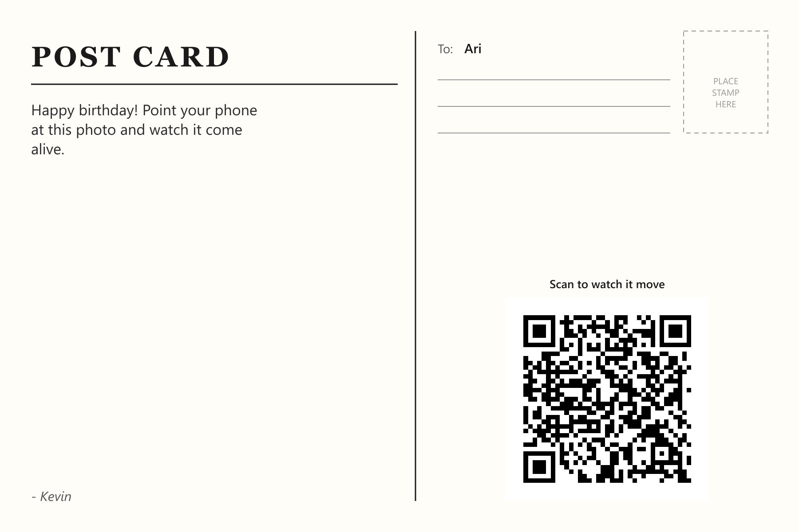

# AR Postcard Studio

Upload a photo and a message. Get back a print-ready postcard whose QR
code opens a WebAR page where the photo comes to life on your phone's
camera.

[](https://github.com/kevin-ayalaaragon/ar-postcard-studio/actions/workflows/ci.yml)
[](https://nextjs.org)
[](https://www.typescriptlang.org)
[](https://www.prisma.io)
[](LICENSE)



*A real, generated output from this app's `/api/postcards/[slug]/print/back` endpoint - not a mockup.*

## Contents

- [What it does](#what-it-does)
- [How it works](#how-it-works)
- [Admin GraphQL API](#admin-graphql-api)
- [Tech stack](#tech-stack)
- [Getting started](#getting-started)
- [Testing](#testing)
- [Environment variables](#environment-variables)
- [Architecture & decisions](#architecture--decisions)
- [Deployment](#deployment)
- [Roadmap](#roadmap)
- [Related project](#related-project)
- [License](#license)

## What it does

This is the full-stack, multi-user successor to
[ar-birthday-postcard](https://github.com/kevin-ayalaaragon/ar-birthday-postcard) -
a one-off, hardcoded WebAR birthday card built as a single gift. This app
generalizes that idea into a real submission pipeline that anyone can use.

## How it works

1. **Submit** (`/`) - a sender uploads a photo, writes a message, and
   names a recipient. This creates a `SUBMITTED` postcard record.
2. **Prepare AR assets (admin, manual for now)** - an admin runs the
   sender's photo through MindAR's
   [image target compiler](https://hiukim.github.io/mind-ar-js-doc/tools/compile/)
   to get a `.mind` tracking file, prepares the matching `.mp4` overlay,
   and uploads both via `/admin`. This flips the record to `READY`.

   > Auto-generating the `.mind`/`.mp4` from the photo instead of this
   > manual step is deliberately out of scope for this MVP - see
   > [Roadmap](#roadmap).

3. **View** (`/postcard/[slug]`) - a WebAR page that tracks the printed
   photo and plays the video on top of it, live camera required.
4. **Print** - the admin downloads print-ready front/back files
   (`/api/postcards/[slug]/print/front` and `.../print/back`, the latter
   pictured above) to send to a print shop.

## Admin GraphQL API

`POST /api/graphql` is a read-only, admin-only GraphQL API beside the REST
routes. It gives the dashboard, and any agent holding the admin secret, a
typed query surface with a fixed cost ceiling: callers choose fields but
cannot page past 50 rows, nest deeper than 6 levels, or exceed the cost
budget. Nothing in it can write. Rationale, rejected options and deferred
work: [ADR 0013](docs/adr/0013-graphql-admin-api.md).

- **Auth before parsing** - the shared admin secret is checked (timing-safe,
  as for every admin surface - [ADR 0007](docs/adr/0007-admin-auth.md))
  before GraphQL Yoga sees the request; anything else gets a 401. POST only,
  no batching, errors masked, CORS off, GraphiQL in development only.
- **Queries** - `postcards(status, first, after)` is a Relay-style cursor
  connection (default 20, at most 50) with keyset pagination on
  `createdAt desc, id desc`; `postcard(slug)` returns one postcard or null.
  An out-of-range `first` is rejected, not silently clamped.
- **Abuse limits** - depth 6, breadth 40, cost 1000, checked before any
  resolver runs; aliases count toward breadth, so repeating a field cannot
  multiply pages past the budget.
- **Contract** - the schema is code-first (Pothos) and printed to a
  checked-in [`schema.graphql`](schema.graphql); a snapshot test fails when
  the two drift (`npm run schema:print` updates it).
- **What stayed REST** - uploads, and the unpaginated admin list, because
  the MCP tool `list_pending_postcards` reads that full array
  ([ADR 0011](docs/adr/0011-admin-mcp-server.md)); a test pins its shape.
- **Admin data only** - `Postcard` includes sender name and message, which
  the public `GET /api/postcards/[slug]` deliberately omits. File fields are
  `/api/files/...` URLs, which contain the storage key.

```bash
curl -s http://localhost:3000/api/graphql \
  -H "content-type: application/json" -H "x-admin-secret: $ADMIN_SECRET" \
  -d '{"query":"{ postcards(status: SUBMITTED, first: 5) { edges { node { slug recipientName createdAt } } pageInfo { hasNextPage endCursor } } }"}'
```

For one table and one first-party client, a paginated REST route or tRPC
would also have worked; the ADR says so. DataLoader waits for the first
relation (no relations means no N+1 yet), and a `createdAt` index and
per-field authorization are deferred with reasons.

### How it was delivered

- **Scoped to what was needed** - read-only and admin-only, with the REST
  contract the MCP tool depends on left unchanged and pinned by a test.
- **Decision recorded before merge** - ADR 0013 lists the drivers, four
  rejected options, the portfolio motive stated openly, and what is deferred.
- **Limits set before exposure** - auth, depth, breadth, cost, page size and
  error masking shipped in the first commit, each with a test.
- **Reviewed and hardened** - a security review found nothing blocking; its
  fixes (cost scoring that ignores negative page sizes, CORS off, accurate
  wording about file URLs) were applied with tests.
- **Readiness evidence** - 100 tests pass; lint, typecheck and build pass; a
  production build was smoke-tested locally (401 without the secret, masked
  errors, the real message for a bad cursor); the Vercel preview built.

## Tech stack

| Layer | Choice | Why |
|---|---|---|
| Framework | Next.js 16 (App Router, TypeScript) | One deployable for pages + API routes - see [ADR 0002](docs/adr/0002-nextjs-monolith.md) |
| Database | Prisma + Postgres (Neon), same provider dev and prod | Type-safe queries, pinned to a stable major - [ADR 0003](docs/adr/0003-database-orm.md); dev/prod parity - [ADR 0009](docs/adr/0009-single-postgres-datasource.md) |
| AR viewer | MindAR.js + A-Frame | Free/open image tracking, carried over from the predecessor project - [ADR 0008](docs/adr/0008-ar-viewer-reuse.md) |
| Print generation | `sharp` + SVG rasterization | Fast, print-quality text layout - [ADR 0005](docs/adr/0005-print-file-generation.md) |
| QR codes | `qrcode` (error correction `H`, 4-module quiet zone) | Print/scan reliability - [ADR 0004](docs/adr/0004-qr-generation.md) |
| File storage | Local disk (dev), Backblaze B2 (prod) | Provider-agnostic `StorageDriver` interface - [ADR 0006](docs/adr/0006-file-storage.md) |
| Admin API | GraphQL Yoga 6 + Pothos 4 (code-first), read-only, beside REST | Typed, cost-limited query surface for the dashboard and agents; tRPC, `pg_graphql` and Apollo rejected - [ADR 0013](docs/adr/0013-graphql-admin-api.md) |
| Hosting | Vercel + Neon + Backblaze B2 | $0/month, no payment method required, conventional Next.js stack - [ADR 0010](docs/adr/0010-hosting-vercel-neon-b2.md) |
| Testing | Vitest (node environment) | Unit and route-handler tests, run in CI - [ADR 0012](docs/adr/0012-vitest-testing.md) |

## Getting started

**Prerequisites:** Node.js 22.15+ (GraphQL Yoga 6's minimum, set in
`package.json` `engines`; developed against 24), npm, and a free
[Neon](https://neon.tech) Postgres branch for local dev (no local Postgres
server or Docker needed - see [ADR 0009](docs/adr/0009-single-postgres-datasource.md)).

```bash
npm install
cp .env.example .env   # set DATABASE_URL/DIRECT_URL to your Neon dev branch, and a real ADMIN_SECRET
npx prisma migrate dev
npm run dev
```

- `http://localhost:3000` - submission form
- `http://localhost:3000/admin` - admin dashboard (enter the `ADMIN_SECRET` from `.env`)

Uploaded/generated files land under `./storage/` (gitignored, local dev
only).

## Testing

```bash
npm test   # vitest run: no database, secrets or network needed
```

The suite calls route handlers directly and covers: the admin shared-secret
check and the 401/401/200 gate on `/mcp` and the admin routes, the MCP tool
surface and annotations, the public submission pipeline (MIME allow-list,
15 MB cap, undecodable-image rejection, dimension extraction), the storage
driver (round trip, path-traversal guard, fail-closed B2 configuration),
QR and print-back generation (decoded back to the exact URL, 1800x1200 at
300 DPI), the `baseUrl()` fallback order, and the GraphQL API (the
401/401/200 gate with no database call on rejection, cursor pagination and
the `first` bounds, depth/breadth/cost rejection with zero database calls,
error masking, no CORS headers, and the `schema.graphql` snapshot). Prisma is mocked and the AR
viewer is not covered; see [ADR 0012](docs/adr/0012-vitest-testing.md).

CI (`.github/workflows/ci.yml`) runs `prisma migrate deploy` against a
Postgres 16 service, then lint, build and `npm test` on every push and
pull request to `main`.

## Environment variables

| Variable | Purpose | Dev default |
|---|---|---|
| `DATABASE_URL` | Prisma connection string, pooled (PgBouncer) | a Neon dev branch |
| `DIRECT_URL` | Prisma Migrate's connection string, unpooled | a Neon dev branch |
| `ADMIN_SECRET` | Shared secret for the admin asset-upload endpoint - see [ADR 0007](docs/adr/0007-admin-auth.md) | generate your own |
| `PUBLIC_BASE_URL` | Base URL baked into each postcard's QR code | `http://localhost:3000` |
| `LOCAL_STORAGE_DIR` | Where the local storage driver writes files (used only when `B2_KEY_ID` is unset) | `./storage` |
| `B2_KEY_ID`, `B2_APPLICATION_KEY`, `B2_BUCKET_NAME`, `B2_REGION` | Backblaze B2 credentials - storage switches to B2 the moment `B2_KEY_ID` is set | unset locally |

Full reference with comments: [`.env.example`](.env.example).

## Architecture & decisions

Every non-obvious technical choice - including ones synthesized rather
than hand-picked - is recorded with a cited source in
**[docs/adr/](docs/adr/README.md)** (MADR format). Resume-relevant skills
this build demonstrates are tracked in
[docs/differentiators.yaml](docs/differentiators.yaml).

## Deployment

Stack: **Vercel** (app) + **Neon** (Postgres) + **Backblaze B2** (object
storage) - all free-tier, $0/month at this project's scale, no payment
method required anywhere in the stack. Rationale and alternatives
considered: [ADR 0010](docs/adr/0010-hosting-vercel-neon-b2.md).

1. **Neon** - create a project at [neon.tech](https://neon.tech), grab the
   pooled and direct connection strings for `DATABASE_URL`/`DIRECT_URL`.
   Create a second branch for local dev so prod stays untouched by local
   testing.
2. **Backblaze B2** - create a bucket, then a non-master application key
   scoped to it, for `B2_KEY_ID`/`B2_APPLICATION_KEY`/`B2_BUCKET_NAME`.
   Note the bucket's region (e.g. `us-west-004`) for `B2_REGION`.
3. **Vercel** - import this repo, set all of the above plus a real
   `ADMIN_SECRET` and `PUBLIC_BASE_URL` (the production domain Vercel
   assigns) as environment variables, then deploy. `vercel-build` (see
   `package.json`) runs `prisma migrate deploy` automatically on every
   deploy, so the database schema stays in sync with the code - no manual
   migration step.

No exotic runtime requirements otherwise - `sharp` needs a Node.js
function (not Edge) runtime, which is Vercel's default for route handlers.

## Roadmap

- [ ] Auto-generate the `.mind` target and animation from the uploaded
      photo instead of the manual admin step.
- [ ] Real session/OAuth-based admin auth ([ADR 0007](docs/adr/0007-admin-auth.md)).
- [x] First live production deploy on Vercel + Neon + Backblaze B2
      ([ADR 0010](docs/adr/0010-hosting-vercel-neon-b2.md)).
- [x] Read-only, admin-only GraphQL API with query cost limits
      ([ADR 0013](docs/adr/0013-graphql-admin-api.md)).
- [ ] GraphQL follow-ups deferred in ADR 0013: DataLoader once a relation
      exists, a `createdAt` index, per-field authorization, persisted
      (trusted) documents for agent callers.

## Related project

[ar-birthday-postcard](https://github.com/kevin-ayalaaragon/ar-birthday-postcard) -
the original single-use WebAR birthday card this project generalizes.
That repo is a printed, already-delivered personal gift and is
intentionally left untouched - see [ADR 0001](docs/adr/0001-new-repo-not-rename.md).

[agentic-project-simulator](https://github.com/kevin-ayalaaragon/agentic-project-simulator) -
a multi-agent LLM evaluation harness that reuses this project's Postgres
platform pattern (Neon, plus a Postgres service container in CI) for its
retrieval layer: hybrid keyword and pgvector search over NIST SP 800-53,
scored against owner-judged labels with a CI regression gate.

## License

[MIT](LICENSE)
